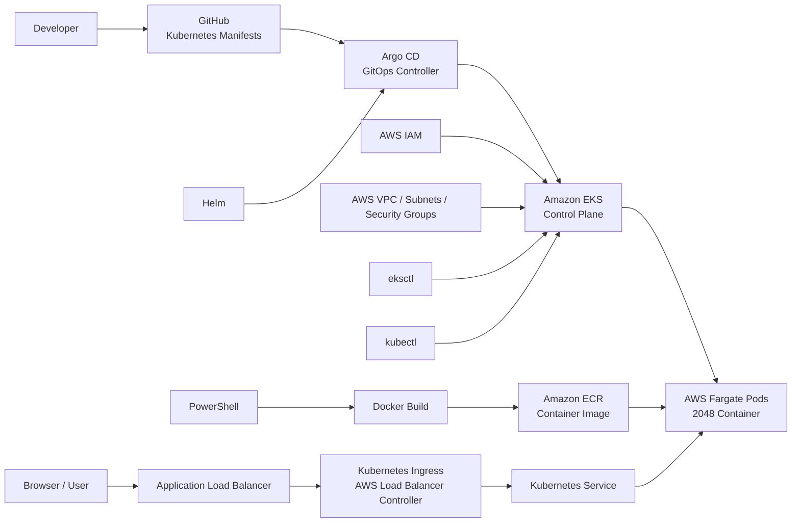

# 2048 Game on AWS EKS with GitOps

2048 game deployed on AWS EKS Fargate with Argo CD GitOps

## What this project does

This project deploys a playable 2048 web application on Amazon EKS using AWS Fargate, exposed through an Application Load Balancer, and managed with Argo CD GitOps.

Instead of applying manifests by hand, the Kubernetes manifests in this repository are the source of truth: a developer updates them in GitHub, Argo CD monitors the repository and synchronizes the desired state to Amazon EKS, and the application is then reachable in a browser through the load balancer.

## Architecture / How it works



The Kubernetes manifests in this repository are:

- `deployment.yaml` — the `deployment-2048` Deployment in the `game-2048` namespace, with 5 replicas of the `app-2048` container on port 80. The container image is pulled from Amazon ECR.
- `service.yaml` — the Kubernetes Service that exposes the 2048 application inside the cluster.
- `ingress.yaml` — the Kubernetes Ingress that exposes the application through the Application Load Balancer.

### End-to-End Flow

1. Developer updates Kubernetes manifests in GitHub.
2. Argo CD monitors GitHub and synchronizes the desired state to Amazon EKS.
3. EKS schedules the 2048 workload on AWS Fargate.
4. The application container image is pulled from Amazon ECR.
5. The AWS Load Balancer Controller provisions an Application Load Balancer for the Kubernetes Ingress.
6. Traffic flows: Browser → ALB → Ingress → Kubernetes Service → Fargate Pod.

## Tech stack


- Amazon EKS
- AWS Fargate
- Application Load Balancer (ALB)
- AWS Load Balancer Controller
- Amazon ECR
- AWS IAM
- AWS VPC, Subnets and Security Groups
- Kubernetes
- kubectl
- eksctl
- Helm
- Docker
- Argo CD
- GitOps
- GitHub
- PowerShell
- Nginx
- 2048 Web Application

## Repository structure

```text
.
├── README.md
├── deployment.yaml
├── service.yaml
├── ingress.yaml
└── docs/images/
    ├── 2048-game.jpg
    └── argocd-gitops.jpg
```

## Key work demonstrated

- Deployed a playable 2048 application on Amazon EKS with AWS Fargate, so no worker nodes need to be managed.
- Used Argo CD GitOps: GitHub holds the Kubernetes manifests, and Argo CD synchronizes them to the cluster.
- Built the container image with Docker and stored it in Amazon ECR for the Fargate pods to pull.
- Exposed the application through a Kubernetes Ingress and Application Load Balancer, with a Kubernetes Service in front of the pods.
- Kept the deployment in GitHub as infrastructure as code, using the manifests in this repository.

## Project Demo

### Playable 2048 Application


### Argo CD GitOps Application


